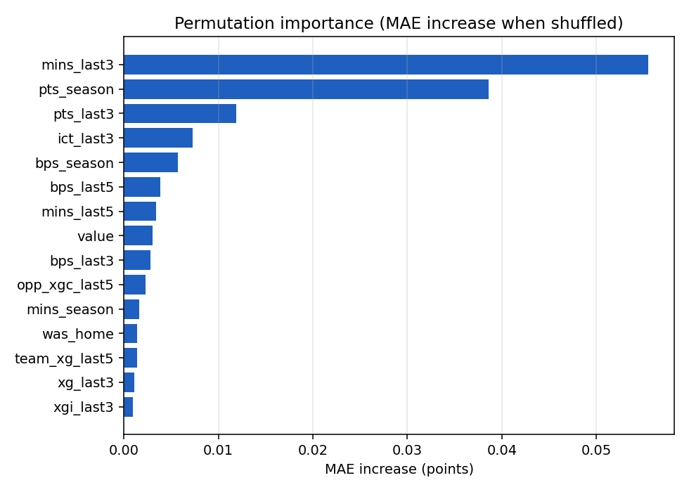
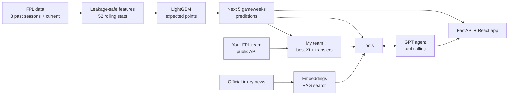
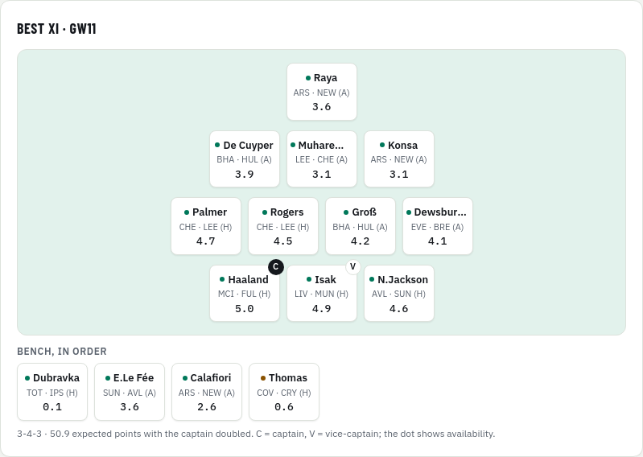
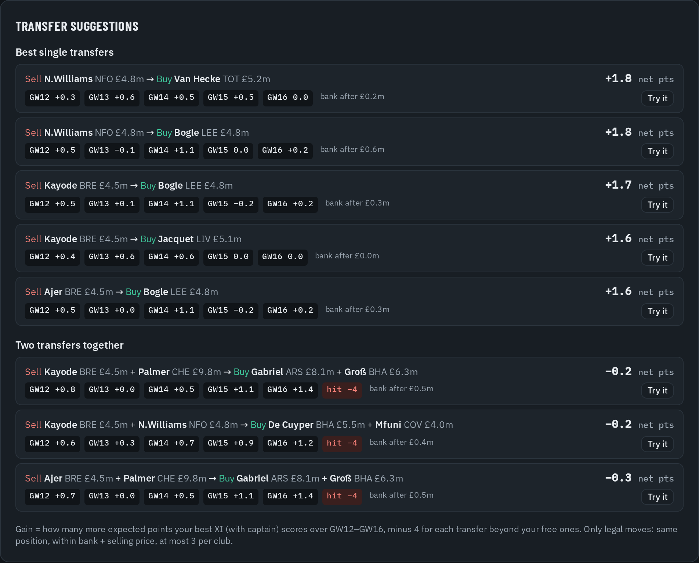

# scout-iq

**An FPL (Fantasy Premier League) scout.** A LightGBM model predicts how many points every player will score in each of the next five gameweeks, and an LLM agent answers questions like *"who should I captain?"* using those predictions and the latest official injury news. Load your own FPL team and get the best XI, captain and transfer suggestions, worked out by deterministic code and explained by the agent. It comes with a React + TypeScript web app.


## Results

Tested **walk-forward on the 2025-26 season**: before each gameweek the model is retrained on every match that kicked off earlier, then predicts that gameweek, exactly like using it live. Hyperparameters were chosen on 2024-25 before the test season was touched.

| 2025-26, players in contention | MAE | RMSE | Captain pick, avg pts | Top-11 picks, avg pts | Rank correlation |
|:--|--:|--:|--:|--:|--:|
| **LightGBM** | **1.877** | **2.746** | **6.97** | **4.75** | **0.450** |
| season average to date (best baseline) | 1.994 | 2.895 | 6.22 | 4.53 | 0.376 |
| form: mean of last 5 | 2.084 | 3.003 | 4.81 | 4.19 | 0.365 |

- **5.8% lower error** than the best baseline, and lower in almost every single gameweek.
- **Better decisions:** captaining the model's top pick scores about 0.75 points more per gameweek, roughly +57 points over a season once the captain's points are doubled. Captain points are an average of only 38 picks, so treat this as noisy: models with near-identical MAE differed by up to 0.35 here.
- **What drives predictions:** minutes over the last 3 matches (does he start?), then season points average, recent points and ICT, then BPS and fixture difficulty.

<p>
  
  
</p>

"Players in contention" means players who played in at least one of their last 3 matches. Most rows are squad players who never play and always score 0, which makes every method look good, so results on all rows are reported too ([full report](results/day2_model.md)).

## How it works



**1. Data.** Past seasons (2023-24 to 2025-26, for training and evaluation) come from [vaastav/Fantasy-Premier-League](https://github.com/vaastav/Fantasy-Premier-League). The current season comes straight from the official FPL API (`bootstrap-static`, `fixtures`, and one `element-summary` per player), so it has every finished gameweek, live prices, injury news and the real next gameweek. `fpl_api.py` writes it in exactly vaastav's files and columns, so nothing downstream knows the difference. Only gameweeks that have fully finished are included, since a half-played gameweek has provisional points and only some teams' matches. A check script compares both sources over the gameweeks they share: identical row counts and identical points, minutes and xG for every player and match. One row per player per match, about 94,000 rows.

**2. Features without leakage.** 52 features per player and match: form and minutes over the last 3 and 5 matches, xG, xA, BPS, ICT, how often he plays 60+ minutes, price, home/away, and his own team's and the opponent's recent goals and xG for and against. Every feature is a rolling average over **earlier** matches only: sorted by kickoff, shifted by one match, grouped by player and season. The model only sees a whitelist of pre-kickoff columns. A **perturbation test** sets a match's points to 99, rebuilds the features and asserts that the features for that match don't change.

**3. Model.** LightGBM with a squared-error objective, so it predicts **expected points (the mean)** rather than the median. That's what you need for ranking and captaincy, since FPL points are skewed by rare hauls. A small grid search uses early stopping on the 2024-25 validation season.

**4. Agent.** GPT (`gpt-4o-mini`) with OpenAI tool calling, running in a loop with a step limit:

| Tool | What it does |
|---|---|
| `get_predictions` | Ranked expected points for the next gameweek, filterable by position, price and team |
| `compare_players` | Side by side: expected points, fixtures, price, availability, recent form |
| `get_news` | **RAG** over official FPL injury news: each item is embedded with OpenAI embeddings and the most similar items are retrieved |
| `analyze_my_team` | The user's squad (sent by the app): best XI, captain, weakest players and legal transfers, from `team.py` |

Predictions for unplayed gameweeks reuse the same pipeline: append a "not yet played" row per player and fixture, and the shifted features become exactly the history up to now. For the next five gameweeks the future fixtures are built in separate slots (each team plays at most once per slot), so every one uses form as of today and only the opponent and venue change; a double gameweek adds both fixtures and a blank is 0. That is also the weakness: the model knows nothing about form, rotation or injuries further ahead, so later gameweeks are shown as less certain (in the app and in the agent's prompt). How fast the error grows with the lead time is the next experiment. The model doesn't read news, so predictions are also scaled by FPL's chance-of-playing figure (for later gameweeks too, unless the news gives a return date like "Expected back 22 Nov"). The system prompt requires every claim to come from tool results and tells the agent the model's typical error so it presents predictions as estimates. Optional **LangSmith** tracing shows every model and tool call.

**5. My team.** Enter your FPL team ID (public data only, never a password) or pick 15 players by hand. The backend reads the squad from the latest passed deadline (`entry/{id}/`, `.../history/`, `.../event/{gw}/picks/`), estimates your free transfers from the history, and `team.py` answers deterministically:

- **Best XI**: 1 GK, at least 3 DEF, 2 MID, 1 FWD. Points add up and the rules only limit counts per position, so for each of the 8 legal formations the best XI is just the top players of each position; try all 8. The squad's best player is always in it, so he's captain; the bench is ordered by expected points.
- **Transfers**: a squad is worth its best XI plus the captain again, every gameweek, summed over five gameweeks. Every legal single transfer (same position, within bank + the seller's price, max 3 per club, not already owned) is scored exactly: about 3,000 swaps; the whole analysis, pairs included, takes about 0.4 s. Pairs are first estimated as the sum of two single gains (a price-sorted running maximum finds the best partner within budget), then the top 60 are re-scored exactly. Each transfer beyond the free ones costs 4 points.
- It's code, not the LLM, because the rules must always hold and the answer must be reproducible and testable; the agent calls it through `analyze_my_team` and explains the result.
- **Shirts**: each player is shown in his club's FPL shirt (goalkeepers in the keeper kit). FPL keys the images by the team `code` from bootstrap-static's `teams`, not by the team id a player's `team` field holds, so the backend maps id -> code and sends `team_code`. The images are FPL's (Premier League-licensed), loaded straight from FPL and never stored here; `frontend/src/lib/shirts.ts` is the one place to swap them for self-drawn shirts, and a plain grey shirt replaces any image that fails to load.
- **Planning on the pitch**: × on a player sells him, + on the empty slot opens the players you can buy (same position, within budget, max 3 per club; players you sold are listed first). Click a starter then a bench player to substitute, or two bench players to change the order; pick the captain and vice. The predicted points for the next gameweek (your XI, captain doubled, minus hits) update with every change, next to what the best XI would score. **Optimise** asks `team.py` for the best XI of the squad on the pitch, **Save** keeps the plan (the chat then uses it), **Reset** goes back to the squad as loaded. Transfers, free transfers and the bank are always counted against the *loaded* squad, so selling a player and buying him back costs nothing.

<p>
  
  
</p>

**Limitations, shown in the app:** selling prices aren't public (FPL keeps half of any price rise), so players are valued at today's price and the bank is editable; free transfers are an estimate you can override; transfers made since the last deadline aren't public yet; bench points and auto-subs are ignored; planned transfers live only in your browser (make them in the FPL app).

**6. App.** A FastAPI backend (`/api/status`, `/api/predictions` (`horizon=1-5`, `rank_by`), `/api/compare`, `/api/news`, `/api/players`, `POST /api/team/analyze`, `POST /api/chat` with per-session memory and an optional `team`; interactive docs at `/docs`) and a **React + TypeScript** frontend in `frontend/`, built with Vite:

- **Predictions table** with the next gameweek plus the four after it (faded: less certain), a five-gameweek total and a rank-by toggle, position, price and team filters (typed filters are debounced), an expected-points bar and an availability badge whose tooltip shows the official injury news.
- **Compare** 2-4 players side by side: expected points, recent form, minutes, xGI, season average and availability. Names the backend can't resolve are shown as *ambiguous* (with the candidates) or *not found* instead of silently disappearing.
- **My team** page: load by team ID (remembered in the browser) or build the squad by hand with the rules checked as you go; plan transfers, substitutions and the captain directly on the pitch with live predicted points, free transfers left, hits and bank (Optimise / Save / Reset); expected points per gameweek, weakest players, transfer suggestions with the gain per gameweek (each can be tried on the pitch), editable bank and free transfers.
- **Chat** with the agent (it knows your loaded team), which keeps the session id so it remembers the conversation and shows the tools it called (name and arguments) under each answer.
- Light and dark mode from the system setting, works down to phone width, fully keyboard usable, respects reduced motion.

All API calls go through **TanStack Query** (loading, error and caching states). The response **types are generated from FastAPI's OpenAPI schema** with `openapi-typescript`: the routes declare Pydantic response models, `scripts/export_openapi.py` writes the schema to `frontend/openapi.json`, and `npm run gen:api` regenerates `src/api/schema.gen.ts`. A backend test fails if the committed schema is out of date, so the backend and frontend can't silently drift apart. Styling is Tailwind CSS; tests use Vitest and React Testing Library against a mocked API. In production FastAPI serves the built app from `frontend/dist/` and returns `index.html` for client-side routes, so new pages only need a route in `frontend/src/app/routes.tsx`.

## Things that went wrong, and what I learned

- **Early stopping on the wrong metric.** The first model stopped after 18 trees. It minimised squared error but early stopping measured MAE, and MAE rewards predicting the median, so every step toward the mean looked worse. The broken model had better MAE on one subset but lost to the baseline on RMSE and on all rows. Matching the stopping metric to the training loss gave 124 trees and a model that's better on every metric. Lesson: never trust a single metric.
- **A leak hiding in plain sight.** The dataset has FPL's own expected points (`xP`). It looked very accurate, but only in the gameweeks where the source stored a separate xP snapshot, and it was worse than a simple average elsewhere. That suggests it was sometimes recorded after the deadline, so it's reported as a reference and never used as a feature.
- **Ownership looked important but added nothing.** Ownership (`log_selected`) was the #3 feature by permutation importance, but it was the only raw, unshifted column, recorded each gameweek at an uncertain time, and the live pipeline could only give the model *last* week's ownership, so training and serving didn't match. I retrained the whole pipeline three ways (same-week ownership, previous-week ownership shifted per gameweek so double gameweeks can't leak, and no ownership) and compared them gameweek by gameweek with a bootstrap over gameweeks ([script](scripts/compare_ownership.py), [results](results/experiments/)). All three were within 0.006 MAE and the model without ownership was marginally best (better than previous-week ownership in 29 of 37 gameweeks), so even the possibly leaky version gave no advantage: minutes and season points already carry the same "regular starter" signal. Ownership is now dropped. Lesson: permutation importance shows what a trained model relies on, not what it needs, because correlated features take over when one is removed.
- **The agent talking about the wrong player.** "Salah" fuzzy-matched a different player, "Salia", because Salah isn't in the current season's data. Name matching now uses exact name words first and fuzzy matching only for clear typos, and it reports ambiguous ("Palmer": Chelsea or Ipswich?) or missing names instead of substituting.

## Limitations and next steps

- **One test season.** Gameweek bootstrapping is so far only used to compare feature variants (the ownership check); the next step is confidence intervals for the model vs the baselines, and repeating comparisons over several random seeds, since the bootstrap doesn't capture training randomness.
- **History resets each season**, so early-season predictions are weaker. Linking players across seasons would help.
- **Predictions further ahead aren't evaluated yet**: how much MAE grows 1, 2, 3 gameweeks ahead with form frozen at the cutoff.
- **My team ignores the bench** (auto-subs) and doesn't value rolling a transfer; selling prices aren't public.
- **The agent isn't evaluated yet.** In a real check it recommended the tool's transfer but added an unsupported "reliable performer" remark. Next is a test set of questions with expected tools and facts, scored automatically and traced in LangSmith.

## Run it

```bash
python -m venv .venv && source .venv/bin/activate
pip install -r requirements.txt
cp .env.example .env                 # add OPENAI_API_KEY (needed for chat and news search)

python scripts/download_data.py      # past seasons (vaastav) + current season (FPL API), ~1 min
python scripts/build_dataset.py      # -> data/processed/features.parquet
python scripts/evaluate_baseline.py  # -> results/day1_baseline.md
python scripts/train_evaluate.py     # -> results/day2_model.md, models/lgbm.txt (~1 min)
python scripts/train_evaluate.py --ownership prev --experiment own_prev  # ablation run: writes to results/experiments/, leaves the deployed model alone

cd frontend && npm ci && npm run build && cd ..   # build the web app once (needs Node, see below)
python scripts/serve.py              # web app at http://localhost:8000 (startup ~1 min)
python scripts/ask.py                # or chat in the terminal
pytest                               # 68 tests, no API key or network needed
```

### Web app

The frontend needs **Node.js 20.19+ or 22.12+** (Node 24 LTS recommended; `frontend/.nvmrc` says 24). On WSL/Linux, with [nvm](https://github.com/nvm-sh/nvm):

```bash
curl -o- https://raw.githubusercontent.com/nvm-sh/nvm/v0.40.3/install.sh | bash   # then open a new terminal
nvm install 24 && nvm use 24
```

**Development** (hot reload), two terminals:

```bash
python scripts/serve.py              # terminal 1: the API on :8000
cd frontend && npm run dev           # terminal 2: open http://localhost:5173
```

Vite forwards `/api` requests to `http://127.0.0.1:8000`, so the browser sees one origin and no CORS setup is needed. API docs stay at http://localhost:8000/docs.

**Production**: `npm run build` in `frontend/` writes `frontend/dist/`, and `python scripts/serve.py` serves it together with the API at http://localhost:8000. If `frontend/dist/` is missing, `serve.py` says how to build it and the API still works.

Frontend scripts (in `frontend/`):

```bash
npm run typecheck                    # tsc, strict mode
npm run lint                         # ESLint (typescript-eslint, react-hooks, jsx-a11y)
npm run test                         # Vitest + React Testing Library, mocked API
npm run build                        # type-check, then build to frontend/dist/
npm run gen:api                      # after changing an API response: refresh openapi.json + TS types
```

## Weekly update

```bash
python scripts/update.py             # after a gameweek finishes: download, rebuild, retrain, summary (~3 min)
python scripts/update.py --quick     # any time: refresh prices, status and injury news only (seconds)
```

Then restart `scripts/serve.py`; the app reads the data once at startup. The full update refetches only the players whose cached history (in `data/cache/fpl_api/`) is older than the latest finished gameweek, so a second run the same week takes seconds. If a gameweek has finished since the last full update, `--quick` warns you, because the app would otherwise predict a gameweek that has already been played.

`download_data.py` flags: `--quick` (as above), `--full` (ignore the cache), `--source vaastav` (old behaviour: everything from vaastav, including the current season). `python scripts/check_api_vs_vaastav.py` repeats the comparison against vaastav.

## Layout

```
src/scout_iq/data.py         load and clean raw gameweek data
src/scout_iq/fpl_api.py      current season from the official FPL API, in vaastav's format; a manager's team
src/scout_iq/features.py     leakage-safe feature engineering
src/scout_iq/evaluate.py     baselines, MAE/RMSE, per-gameweek error
src/scout_iq/model.py        LightGBM, hyperparameter search, walk-forward evaluation
src/scout_iq/fpl_metrics.py  captain and top-11 pick quality, rank correlation
src/scout_iq/upcoming.py     predictions for the next 5 (unplayed) gameweeks
src/scout_iq/team.py         best XI, captain, weakest players, transfer search (deterministic)
src/scout_iq/news.py         RAG over injury news (OpenAI embeddings, cosine similarity)
src/scout_iq/tools.py        the agent's tools + JSON schemas, strict name matching
src/scout_iq/agent.py        tool-calling loop, system prompt, LangSmith tracing
src/scout_iq/api.py          FastAPI backend: routes, response models, serves frontend/dist/
frontend/                    React + TypeScript web app (Vite)
  src/api/                   fetch client, TanStack Query hooks, generated OpenAPI types
  src/app/                   routes and page layout (add new pages in routes.tsx)
  src/features/              predictions, compare, chat, my team, status header and model card
  src/components/, src/lib/  shared UI (badge, tooltip, card) and helpers
  openapi.json               API schema snapshot the types are generated from
scripts/                     download, build, evaluate, train, serve, ask, weekly update, API-vs-vaastav check,
                             ownership-experiment comparison, OpenAPI export
tests/                       leakage tests; agent, tools, retrieval and API tests with fake OpenAI clients
                             (incl. frontend serving and the OpenAPI snapshot);
                             FPL API mapping tests on saved responses (tests/fixtures/)
results/                     evaluation tables and plots; experiments/ holds the ownership ablation runs
models/                      trained model + metadata
```
