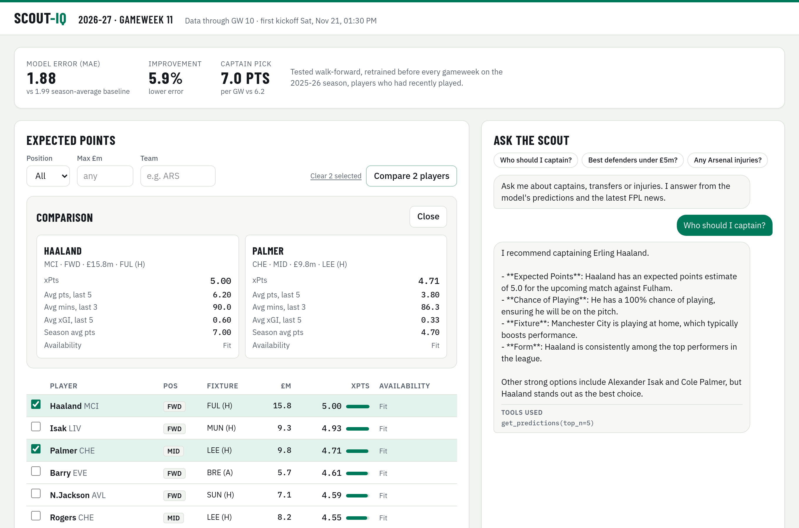
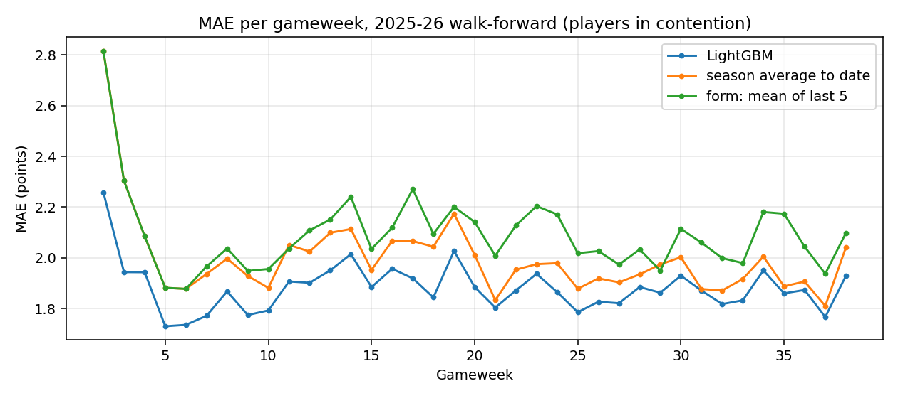
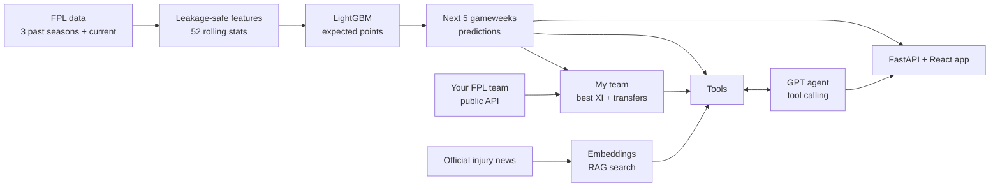
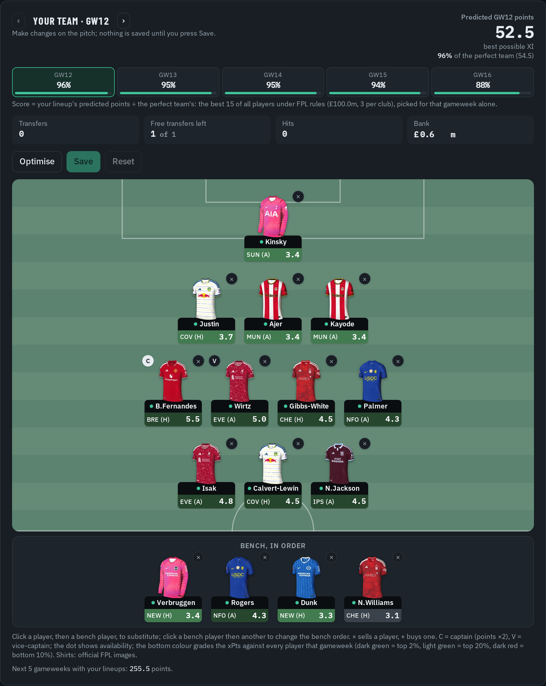
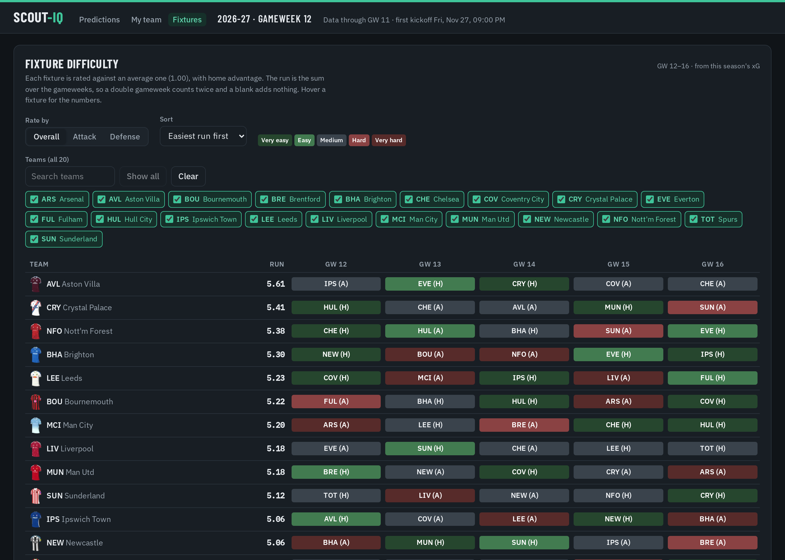

# scout-iq

**An FPL (Fantasy Premier League) scout.** A LightGBM model predicts every player's points for the next five gameweeks. An LLM agent answers questions like *"who should I captain?"* from those predictions and the official injury news. Load your FPL team to get the best XI, captain and transfers, worked out by deterministic code and explained by the agent.



## Results

Tested **walk-forward on the 2025-26 season**: before each gameweek the model is retrained on every earlier match and then predicts that gameweek, as it would be used live. Hyperparameters were tuned on 2024-25 only.

| 2025-26, players in contention | MAE | RMSE | Captain pick, avg pts | Top-11 picks, avg pts | Rank correlation |
|:--|--:|--:|--:|--:|--:|
| **LightGBM** | **1.877** | **2.746** | **6.97** | **4.75** | **0.450** |
| season average to date (best baseline) | 1.994 | 2.895 | 6.22 | 4.53 | 0.376 |
| form: mean of last 5 | 2.084 | 3.003 | 4.81 | 4.19 | 0.365 |

- **5.9% lower error** than the best baseline, and lower in almost every gameweek.
- **Better picks:** the model's captain scores about 0.75 points more per gameweek. That comes from only 38 picks, so it is noisy.
- **What matters most:** minutes over the last 3 matches (does he start?), then season and recent points.

<p>
  
  
</p>

"In contention" = played in at least one of his last 3 matches. Squad players who never play always score 0 and make every method look good ([full report](results/day2_model.md), all rows included).

## How it works



- **Data:** past seasons from [vaastav/Fantasy-Premier-League](https://github.com/vaastav/Fantasy-Premier-League), the current season from the official FPL API, written in the same format. About 94,000 player-match rows.
- **Features:** 52 rolling stats (form, minutes, xG, xA, BPS, price, home/away, team and opponent strength). Each one uses **earlier matches only**, and a test checks that changing a match's points never changes that match's features.
- **Model:** LightGBM with squared error, so it predicts the **mean** (expected points), which is what ranking and captaincy need. Later gameweeks reuse today's form with the new opponent, and everything is scaled by FPL's chance of playing.
- **Agent:** `gpt-4o-mini` with tool calling. Its tools get predictions, compare players, search injury news (**RAG** with OpenAI embeddings) and analyse your team. Every claim must come from a tool result.
- **My team:** load a team by ID (public data, never a password) or pick 15 players by hand. `team.py` finds the best XI and captain, then scores every legal transfer exactly over five gameweeks (about 0.4 s). This is code, not the LLM, so the rules always hold and the answer can be tested.
- **Planner:** plan transfers, subs and the captain on the pitch for each of the next five gameweeks. Each gameweek is scored against the best possible team for that week.
- **Fixture difficulty:** attack and defence strength from our own xG data (FPL's ratings are empty this season), weighted toward recent matches.
- **App:** FastAPI backend and a React + TypeScript frontend (Vite, TanStack Query, Tailwind). The TypeScript types are generated from the API's OpenAPI schema, and a test fails if they drift.

<p>
  
  
</p>



## Things that went wrong

- **Early stopping on the wrong metric.** Training minimised squared error but stopped on MAE, which rewards the median, so it stopped after 18 trees. Stopping on the training loss gave 124 trees and a better model on every metric.
- **A leak in the data.** FPL's own `xP` looked very accurate, but it was sometimes recorded after the deadline. It is never used as a feature.
- **Ownership looked important but added nothing.** It was the #3 feature, yet retraining with and without it changed MAE by under 0.006. Minutes already carry the same signal, so it was dropped ([experiment](results/experiments/)).
- **The agent picked the wrong player.** "Salah" matched "Salia". Names now match exact words first and report ambiguous or missing names instead of guessing.

## Limitations and next steps

- Only one test season, and no confidence intervals yet for model vs baseline.
- Accuracy 2-5 gameweeks ahead isn't measured yet.
- Player history resets each season, so early-season predictions are weaker.
- My team ignores bench points, and selling prices aren't public.
- The agent isn't evaluated yet and sometimes adds claims the tools didn't give.

## Run it

```bash
python -m venv .venv && source .venv/bin/activate
pip install -r requirements.txt
cp .env.example .env                 # add OPENAI_API_KEY (for chat and news search)

python scripts/download_data.py      # past seasons + current season, ~1 min
python scripts/build_dataset.py      # -> data/processed/features.parquet
python scripts/train_evaluate.py     # -> results/day2_model.md, models/lgbm.txt

cd frontend && npm ci && npm run build && cd ..   # needs Node 24 (frontend/.nvmrc)
python scripts/serve.py              # app at http://localhost:8000, API docs at /docs
pytest                               # backend tests, no API key or network needed
```

For development with hot reload, run `python scripts/serve.py` and `cd frontend && npm run dev`, then open http://localhost:5173. Frontend checks: `npm run typecheck`, `lint`, `test`.

**Weekly:** `python scripts/update.py` after a gameweek finishes (download, rebuild, retrain), or `--quick` for prices and injury news only. Then restart `serve.py`.

## Layout

```
src/scout_iq/   data, features, model, evaluation, predictions, fixture difficulty,
                team optimiser (team.py), news RAG, agent tools and loop, FastAPI app
frontend/       React + TypeScript app (pages, features, generated API types)
scripts/        download, build, train, serve, ask, weekly update
tests/          leakage, agent, tools, team and API tests (fake OpenAI clients, saved FPL responses)
results/        evaluation tables, plots and experiments
```
