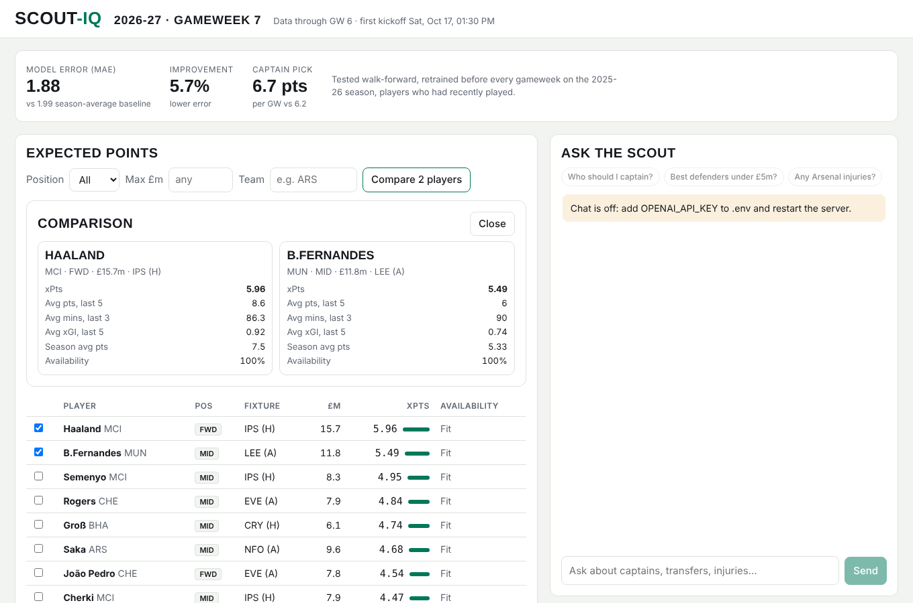
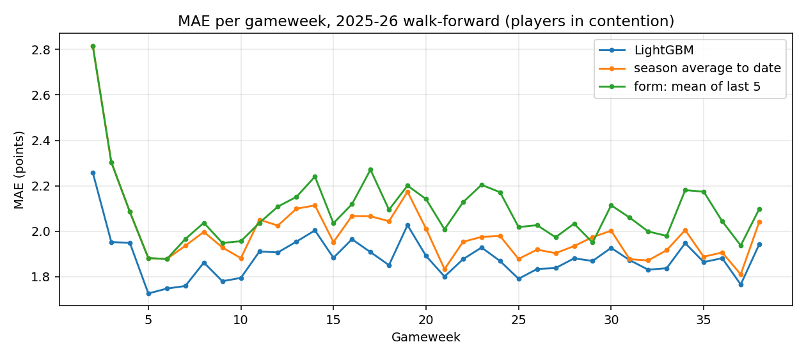
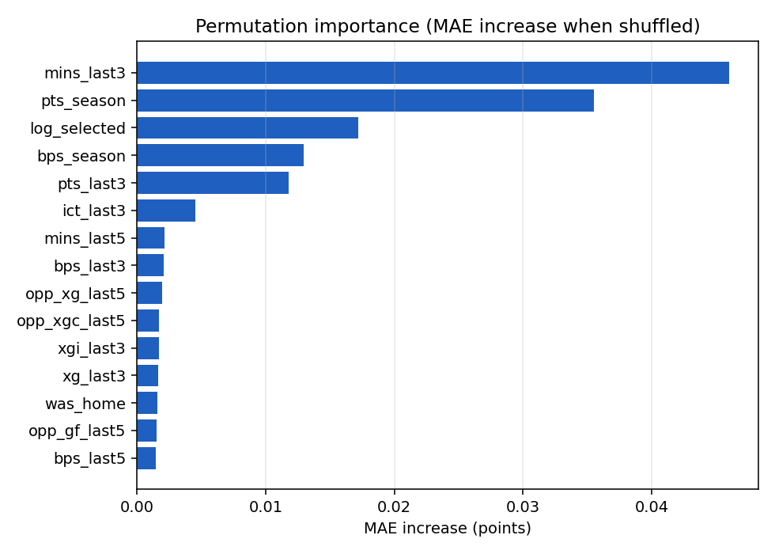
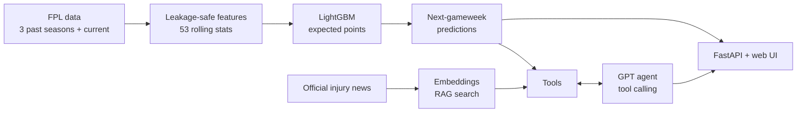

# scout-iq

**An FPL (Fantasy Premier League) scout.** A LightGBM model predicts how many points every player will score in the next gameweek, and an LLM agent answers questions like *"who should I captain?"* using those predictions and the latest official injury news. It comes with a small web app.



## Results

Tested **walk-forward on the 2025-26 season**: before each gameweek the model is retrained on every match that kicked off earlier, then predicts that gameweek, exactly like using it live. Hyperparameters were chosen on 2024-25 before the test season was touched.

| 2025-26, players in contention | MAE | RMSE | Captain pick, avg pts | Top-11 picks, avg pts | Rank correlation |
|:--|--:|--:|--:|--:|--:|
| **LightGBM** | **1.880** | **2.745** | **6.73** | **4.79** | **0.448** |
| season average to date (best baseline) | 1.994 | 2.895 | 6.22 | 4.53 | 0.376 |
| form: mean of last 5 | 2.084 | 3.003 | 4.81 | 4.19 | 0.365 |

- **5.7% lower error** than the best baseline, and lower in almost every single gameweek.
- **Better decisions:** captaining the model's top pick scores about 0.5 points more per gameweek, roughly +38 points over a season once the captain's points are doubled.
- **What drives predictions:** minutes over the last 3 matches (does he start?), then season points average, ownership and BPS, then fixture difficulty.

<p>
  
  
</p>

"Players in contention" means players who played in at least one of their last 3 matches. Most rows are squad players who never play and always score 0, which makes every method look good, so results on all rows are reported too ([full report](results/day2_model.md)).

## How it works



**1. Data.** Past seasons (2023-24 to 2025-26, for training and evaluation) come from [vaastav/Fantasy-Premier-League](https://github.com/vaastav/Fantasy-Premier-League). The current season comes straight from the official FPL API (`bootstrap-static`, `fixtures`, and one `element-summary` per player), so it has every finished gameweek, live prices, injury news and the real next gameweek. `fpl_api.py` writes it in exactly vaastav's files and columns, so nothing downstream knows the difference. Only gameweeks that have fully finished are included, since a half-played gameweek has provisional points and only some teams' matches. A check script compares both sources over the gameweeks they share: identical row counts and identical points, minutes and xG for every player and match. One row per player per match, about 94,000 rows.

**2. Features without leakage.** 53 features per player and match: form and minutes over the last 3 and 5 matches, xG, xA, BPS, ICT, how often he plays 60+ minutes, price, ownership, home/away, and his own team's and the opponent's recent goals and xG for and against. Every feature is a rolling average over **earlier** matches only: sorted by kickoff, shifted by one match, grouped by player and season. The model only sees a whitelist of pre-kickoff columns. A **perturbation test** sets a match's points to 99, rebuilds the features and asserts that the features for that match don't change.

**3. Model.** LightGBM with a squared-error objective, so it predicts **expected points (the mean)** rather than the median. That's what you need for ranking and captaincy, since FPL points are skewed by rare hauls. A small grid search uses early stopping on the 2024-25 validation season.

**4. Agent.** GPT (`gpt-4o-mini`) with OpenAI tool calling, running in a loop with a step limit:

| Tool | What it does |
|---|---|
| `get_predictions` | Ranked expected points for the next gameweek, filterable by position, price and team |
| `compare_players` | Side by side: expected points, fixtures, price, availability, recent form |
| `get_news` | **RAG** over official FPL injury news: each item is embedded with OpenAI embeddings and the most similar items are retrieved |

Predictions for an unplayed gameweek reuse the same pipeline: append a "not yet played" row per player and fixture, and the shifted features become exactly the history up to now. The model doesn't read news, so predictions are also scaled by FPL's chance-of-playing figure. The system prompt requires every claim to come from tool results and tells the agent the model's typical error so it presents predictions as estimates. Optional **LangSmith** tracing shows every model and tool call.

**5. App.** FastAPI backend (`/api/predictions`, `/api/compare`, `/api/news`, `/api/chat` with per-session memory) and a one-page UI. Interactive API docs are at `/docs`.

## Things that went wrong, and what I learned

- **Early stopping on the wrong metric.** The first model stopped after 18 trees. It minimised squared error but early stopping measured MAE, and MAE rewards predicting the median, so every step toward the mean looked worse. The broken model had better MAE on one subset but lost to the baseline on RMSE and on all rows. Matching the stopping metric to the training loss gave 124 trees and a model that's better on every metric. Lesson: never trust a single metric.
- **A leak hiding in plain sight.** The dataset has FPL's own expected points (`xP`). It looked very accurate, but only in the gameweeks where the source stored a separate xP snapshot, and it was worse than a simple average elsewhere. That suggests it was sometimes recorded after the deadline, so it's reported as a reference and never used as a feature.
- **The agent talking about the wrong player.** "Salah" fuzzy-matched a different player, "Salia", because Salah isn't in the current season's data. Name matching now uses exact name words first and fuzzy matching only for clear typos, and it reports ambiguous ("Palmer": Chelsea or Ipswich?) or missing names instead of substituting.

## Limitations and next steps

- **One test season and no confidence intervals.** The model wins almost every gameweek, but the next step is bootstrapping over gameweeks.
- **Ownership might leak slightly.** It's a top-3 feature but is recorded per gameweek at an uncertain time. Retest using the previous gameweek's ownership.
- **History resets each season**, so early-season predictions are weaker. Linking players across seasons would help.
- **The agent isn't evaluated yet.** Next is a test set of questions with expected tools and facts, scored automatically and traced in LangSmith.

## Run it

```bash
python -m venv .venv && source .venv/bin/activate
pip install -r requirements.txt
cp .env.example .env                 # add OPENAI_API_KEY (needed for chat and news search)

python scripts/download_data.py      # past seasons (vaastav) + current season (FPL API), ~1 min
python scripts/build_dataset.py      # -> data/processed/features.parquet
python scripts/evaluate_baseline.py  # -> results/day1_baseline.md
python scripts/train_evaluate.py     # -> results/day2_model.md, models/lgbm.txt (~1 min)

python scripts/serve.py              # web app at http://localhost:8000 (startup ~1 min)
python scripts/ask.py                # or chat in the terminal
pytest                               # 24 tests, no API key or network needed
```

## Weekly update

```bash
python scripts/update.py             # after a gameweek finishes: download, rebuild, retrain, summary (~3 min)
python scripts/update.py --quick     # any time: refresh prices, status and injury news only (seconds)
```

Then restart `scripts/serve.py`; the app reads the data once at startup. The full update refetches only the players whose cached history (in `data/cache/fpl_api/`) is older than the latest finished gameweek, so a second run the same week takes seconds. If a gameweek has finished since the last full update, `--quick` warns you, because the app would otherwise predict a gameweek that has already been played.

`download_data.py` flags: `--quick` (as above), `--full` (ignore the cache), `--source vaastav` (old behaviour: everything from vaastav, including the current season). `python scripts/check_api_vs_vaastav.py` repeats the comparison against vaastav.

## Layout

```
src/scout_iq/data.py         load and clean raw gameweek data
src/scout_iq/fpl_api.py      current season from the official FPL API, in vaastav's format
src/scout_iq/features.py     leakage-safe feature engineering
src/scout_iq/evaluate.py     baselines, MAE/RMSE, per-gameweek error
src/scout_iq/model.py        LightGBM, hyperparameter search, walk-forward evaluation
src/scout_iq/fpl_metrics.py  captain and top-11 pick quality, rank correlation
src/scout_iq/upcoming.py     predictions for the next (unplayed) gameweek
src/scout_iq/news.py         RAG over injury news (OpenAI embeddings, cosine similarity)
src/scout_iq/tools.py        the agent's tools + JSON schemas, strict name matching
src/scout_iq/agent.py        tool-calling loop, system prompt, LangSmith tracing
src/scout_iq/api.py          FastAPI backend
src/scout_iq/static/         web UI
scripts/                     download, build, evaluate, train, serve, ask, weekly update, API-vs-vaastav check
tests/                       leakage tests; agent, tools, retrieval and API tests with fake OpenAI clients;
                             FPL API mapping tests on saved responses (tests/fixtures/)
results/                     evaluation tables and plots
models/                      trained model + metadata
```
