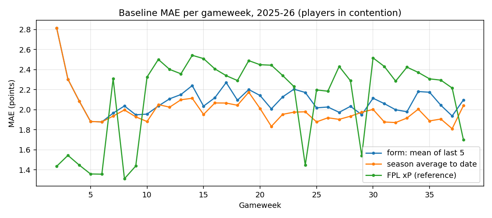

# Day 1: baselines

Mean absolute error (points per player per fixture). Lower is better.

## Players in contention (played in at least one of their last 3 fixtures)

| method                 |   2023-24 |   2024-25 |   2025-26 |   2026-27 |
|:-----------------------|----------:|----------:|----------:|----------:|
| FPL xP (reference)     |     1.528 |     1.516 |     2.121 |   n/a     |
| form: mean of last 5   |     1.962 |     1.894 |     2.084 |     2.082 |
| season average to date |     1.868 |     1.81  |     1.994 |     2.077 |
| zero (always 0)        |     2.147 |     2.138 |     2.365 |     2.372 |

## All rows (includes squad players who never play)

| method                 |   2023-24 |   2024-25 |   2025-26 |   2026-27 |
|:-----------------------|----------:|----------:|----------:|----------:|
| FPL xP (reference)     |     0.85  |     0.941 |     1.07  |   n/a     |
| form: mean of last 5   |     0.995 |     1.09  |     1.047 |     1.271 |
| season average to date |     1.014 |     1.105 |     1.064 |     1.276 |
| zero (always 0)        |     1.068 |     1.213 |     1.164 |     1.41  |

`FPL xP` is the official expected-points figure stored in the dataset. It is a reference,
not a fair baseline: we can't verify when it was captured, so it may include information
from after the deadline. The per-gameweek plot backs this up: in 2025-26 xP is far more
accurate exactly in the gameweeks where the dataset has a separate xP snapshot
(GW 1-9, 24, 29, 38) and worse than the simple baselines elsewhere, so we never use it
as a feature. It isn't in the official FPL API, so the current season has no xP (n/a).

