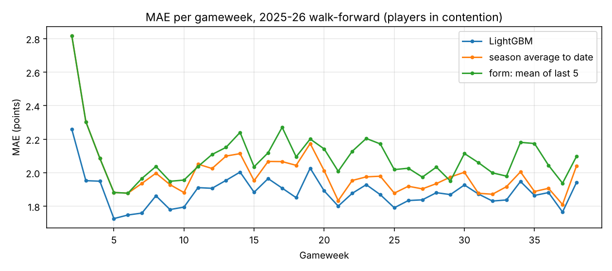
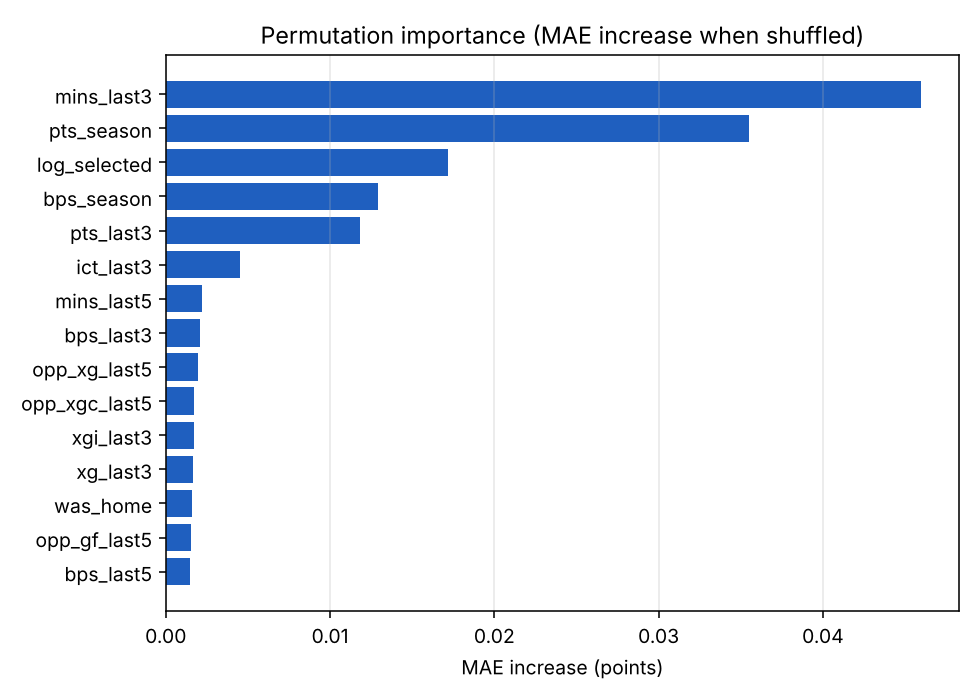

# Day 2: LightGBM vs baselines

Walk-forward on 2025-26: for every gameweek the model is retrained on all fixtures that
kicked off before it, then predicts that gameweek. Hyperparameters were chosen on
2024-25 (trained on 2023-24) before the test season was touched.

**LightGBM improves MAE by 5.7% over the best baseline** for players in contention.

## Players in contention

| method                 |   MAE |   RMSE |
|:-----------------------|------:|-------:|
| LightGBM               | 1.88  |  2.745 |
| season average to date | 1.994 |  2.895 |
| form: mean of last 5   | 2.084 |  3.003 |

## All rows

| method                 |   MAE |   RMSE |
|:-----------------------|------:|-------:|
| LightGBM               | 0.998 |  1.936 |
| season average to date | 1.064 |  2.078 |
| form: mean of last 5   | 1.047 |  2.127 |

## Picks (one row per player per gameweek, players in contention)

`captain_pts_per_GW`: average actual points of each method's #1 pick. `top11_avg_pts`: average
actual points of its 11 highest predictions. `spearman_rho`: rank correlation between predicted
and actual points within each gameweek. `oracle` knows the results and shows the ceiling.

| method                 |   captain_pts_per_GW |   top11_avg_pts |   spearman_rho |
|:-----------------------|---------------------:|----------------:|---------------:|
| LightGBM               |                6.73  |           4.786 |          0.448 |
| season average to date |                6.216 |           4.506 |          0.376 |
| form: mean of last 5   |                5     |           4.15  |          0.365 |
| oracle                 |               17.189 |          12.666 |        nan     |

## Feature importance

Permutation importance on the test season: how much MAE gets worse when one feature is
shuffled. Measured with a model trained only on earlier seasons.

| feature       |   MAE_increase |
|:--------------|---------------:|
| mins_last3    |         0.046  |
| pts_season    |         0.0355 |
| log_selected  |         0.0172 |
| bps_season    |         0.0129 |
| pts_last3     |         0.0118 |
| ict_last3     |         0.0045 |
| mins_last5    |         0.0022 |
| bps_last3     |         0.0021 |
| opp_xg_last5  |         0.002  |
| opp_xgc_last5 |         0.0017 |
| xgi_last3     |         0.0017 |
| xg_last3      |         0.0016 |
| was_home      |         0.0016 |
| opp_gf_last5  |         0.0015 |
| bps_last5     |         0.0015 |

## Hyperparameters

Chosen: num_leaves=15, min_child_samples=100,
n_estimators=124 (early stopping), learning_rate=0.03.
Full grid in `day2_grid.csv`.
